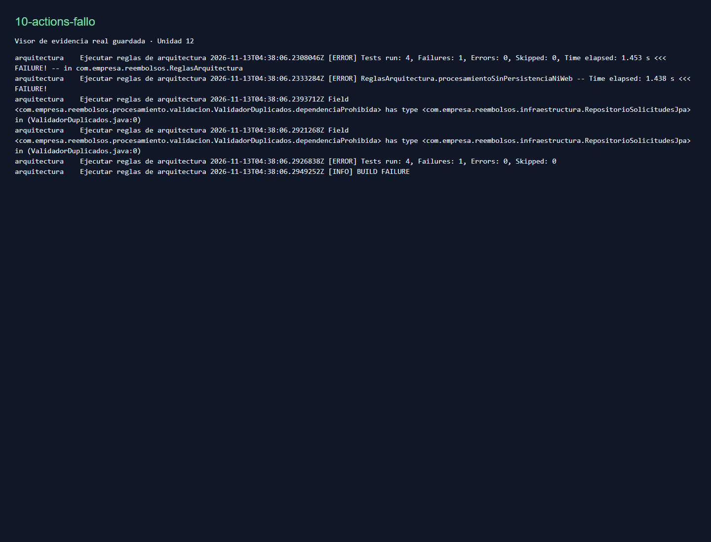
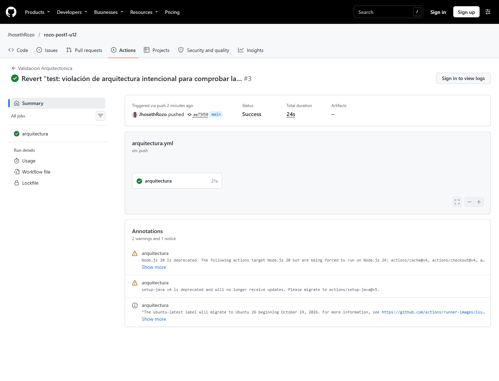
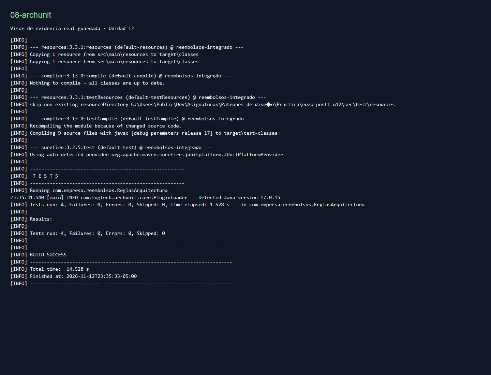
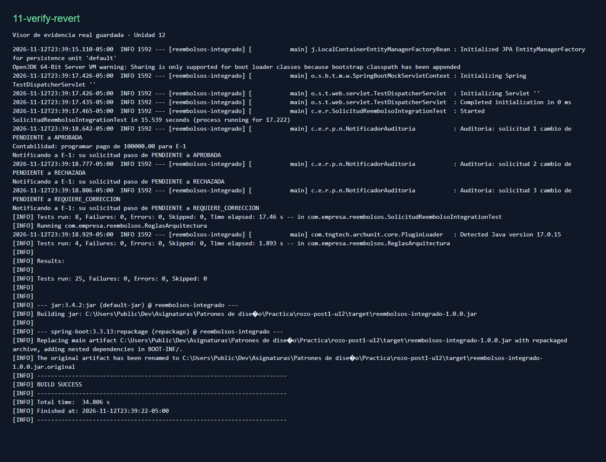

# Reembolsos Integrado — Unidad 12

Autor: Jhoseth Esneider Rozo Carrillo. Proyecto integrador de Patrones de Diseño de Software.


## Diseño Propuesto

Esta sección se versiona con el dominio antes de implementar los patrones.

| Requisito | Punto de variabilidad | Patrón | Justificación en una oración |
| --- | --- | --- | --- |
| RF1 | Verificaciones independientes que pueden crecer y detener el procesamiento | Chain of Responsibility | Cada eslabón comprueba una condición y solo delega cuando es válida, permitiendo agregar verificaciones sin modificar las existentes. |
| RF2 | Fórmula de monto aprobado según categoría | Strategy | Cada categoría aporta un algoritmo intercambiable seleccionado por su clave, sin mezclar sus fórmulas en el servicio. |
| RF3 | Interesados y reacciones ante cambios de estado | Observer | El servicio comunica el cambio a una colección de observadores mediante una interfaz y cada interesado decide cómo reaccionar. |

La persistencia será JpaRepository sobre el dominio, sin puerto intermedio. Para respetar simultáneamente
ese contrato y el dominio sin imports de JPA, el mapeo se declarará externamente en META-INF/orm.xml.
Las notificaciones serán síncronas, como la lista del enunciado: todos los interesados participan
en el mismo cambio, sin prometer ejecución paralela ni entrega distribuida.

## Decisiones de diseño

### 1. Orden de validación

Documentos → monto → duplicados. Las dos primeras comprobaciones son constantes y el recorrido
de pendientes es O(n); detenerse antes ahorra ese recorrido. Colocar duplicados primero daría prioridad
a ese motivo, pero pagaría el costo aun cuando faltaran documentos. El servicio carga la lista antes
de validar, como el ejemplo: este orden ahorra comparación, no la consulta SQL previa.

### 2. Selección de calculadora

Un mapa construido con List<CalculadoraReembolso> inyectada evita modificar el selector cuando
se registra otra estrategia. Un switch exige editarlo por cada categoría. El enum sí debe ampliarse
si aparece BIENESTAR: no se promete extensión sin cambiar absolutamente ningún archivo, sino sin
modificar las fórmulas ni el selector existentes. Las claves duplicadas fallan al construir el mapa.

### 3. Decisión arquitectónica

Se conservan capas simples para persistencia, pues no hay plan de sustituir JPA ni un horizonte
documentado de tres años con cambios de infraestructura. La API externa anunciada por Contabilidad
sí es real, pero ObservadorCambioEstado ya permite cambiar esa implementación sin tocar el servicio.
El [ADR-001](docs/adr/ADR-001.md) desarrolla alternativas, consecuencias positivas/negativas y señales
para reconsiderarlas. El acoplamiento de aplicación a Spring Data es deliberado, no Hexagonal completa.

### 4. Límites de ArchUnit y estereotipos de Spring

@Component permite descubrir colaboradores y no ejecuta consultas ni introduce transporte web.
Se permite org.springframework.stereotype y se prohíben Spring Data, JPA, infraestructura y web
desde procesamiento. Prohibir todo Spring contradiría los componentes requeridos sin mejorar el
aislamiento de las reglas de negocio frente a persistencia/web.

Se ajustan dos defectos del ejemplo para que las reglas comprueben el contrato real: la tercera
selecciona clases Calculadora*, pues SelectorCalculadora no es una estrategia; la segunda permite
el acceso del controlador a sus propios campos/constructor, sin habilitar acceso al repositorio.
Las reglas importan solo producción y Surefire incluye explícitamente ReglasArquitectura en verify:
su nombre no coincide con las convenciones predeterminadas de *Test.

## Resumen de ADR-001

Persistencia directa mediante JpaRepository; dominio puro con mapeo externo XML; notificación
por Observer sin un bus adicional. Se acepta tener que introducir un puerto si aparece una alternativa
real a JPA. Observer permite sustituir un notificador, pero no aporta reintentos ni entrega garantizada.

## Qué se descartó y por qué

| Alternativa considerada | Motivo concreto del descarte hoy | Señal para reconsiderarla |
| --- | --- | --- |
| ApplicationEventPublisher y @EventListener | Tres observadores conocidos ya están desacoplados por una interfaz; el bus agrega indirección y dificulta seguir quién reacciona (KISS). | Suscripciones entre módulos independientes o necesidades transaccionales de eventos documentadas. |
| Visitor/Abstract Factory para exportadores | RF1-RF3 no piden exportación, ni siquiera CSV: el ejemplo de la guía no crea un requisito nuevo; no se cumple Rule of Three. | Requisitos reales de varios formatos con variación estable y repetida. |
| Una excepción por cada validador (decisión propia) | Todos los errores de validación tienen la misma reacción HTTP 400 y solo cambia el motivo; una jerarquía no produce comportamiento distinto (YAGNI/test de explicabilidad). | Clientes que deban recuperar cada error de forma diferente, con códigos y contratos independientes. |
| State para transiciones (decisión propia) | No hay una matriz de transiciones ni acciones de entrada/salida especificadas; añadirla ahora inventaría restricciones. | Finanzas define transiciones permitidas, reversión y reglas por estado. |

## Ejecución y estructura

Proyecto **Java 17 / Spring Boot 3.3.13 / Maven**, con Spring Web, Spring Data JPA, H2,
JUnit 5, Mockito y ArchUnit 1.2.1. No requiere base externa ni credenciales.

```bash
mvn clean package
mvn test -Dtest=ReglasArquitectura
mvn verify
mvn spring-boot:run
```

El servidor inicia en http://localhost:8080; H2 se crea en memoria. El wrapper también está
disponible como `./mvnw` o `.\mvnw.cmd`. JAVA_HOME debe apuntar a JDK 17. Si el perfil de Windows
contiene `&`, usar una carpeta temporal dentro del proyecto para que Surefire arranque correctamente:

```powershell
New-Item -ItemType Directory -Force .tmp | Out-Null
$env:TEMP = Join-Path (Get-Location) '.tmp'
$env:TMP = $env:TEMP
mvn verify
```

```text
src/main/java/com/empresa/reembolsos/
├── ReembolsosApplication.java
├── dominio/{SolicitudReembolso,CategoriaGasto,EstadoSolicitud}.java
├── procesamiento/
│   ├── validacion/{ResultadoValidacion,ValidadorSolicitud,ValidadorDocumentosSoporte,
│   │              ValidadorMontoMaximo,ValidadorDuplicados,CadenaValidadores}.java
│   ├── calculo/{CalculadoraReembolso,CalculadoraViaje,CalculadoraRepresentacion,
│   │           CalculadoraCapacitacion,SelectorCalculadora}.java
│   └── notificacion/{ObservadorCambioEstado,NotificadorEmpleado,
│                     NotificadorContabilidad,NotificadorAuditoria}.java
├── aplicacion/{SolicitudReembolsoService,SolicitudInvalidaException}.java
├── infraestructura/RepositorioSolicitudesJpa.java
└── adaptadores/rest/SolicitudReembolsoController.java
src/main/resources/META-INF/orm.xml
src/test/java/com/empresa/reembolsos/
├── ReglasArquitectura.java
├── SolicitudReembolsoIntegrationTest.java
├── Datos.java
└── procesamiento/{validacion,calculo}/...Test.java
.github/workflows/arquitectura.yml
docs/adr/ADR-001.md
```

## Contrato REST

```http
POST /api/solicitudes
Content-Type: application/json

{
  "empleadoId": "E-1",
  "categoria": "VIAJE",
  "montoSolicitado": 100000,
  "fechaGasto": "2026-08-10",
  "diasViaje": 2,
  "documentosSoporte": true
}
```

Devuelve HTTP 200 con ID generado, monto aprobado 100000 y estado PENDIENTE. Para REPRESENTACION
el mismo monto produce 100000 y para CAPACITACION, 80000. El ID, monto aprobado y estado enviados
por el cliente no se aceptan como decisiones de creación: se asignan en el servicio. Campos
obligatorios ausentes, montos no positivos, días de viaje inválidos y validaciones rechazadas
producen HTTP 400; la falta de documentos devuelve `Faltan documentos soporte`.

```http
PUT /api/solicitudes/1/estado
Content-Type: application/json

"APROBADA"
```

El cuerpo es el enum como cadena JSON, no un objeto. También se prueban RECHAZADA y
REQUIERE_CORRECCION. Los tres observadores reciben el cambio, pero Contabilidad solo imprime
la programación del pago para APROBADA. Un ID inexistente devuelve HTTP 404.

## Verificación funcional y arquitectónica

La entrega final ejecuta **25 pruebas**: 13 casos unitarios en seis clases (los tres validadores
y las tres calculadoras), ocho casos `@SpringBootTest` con MockMvc/H2 y **cuatro reglas ArchUnit**.
La integración usa spies de observadores reales, verifica invocaciones, salida de empleado/auditoría,
ausencia de pago en rechazos/correcciones, persistencia y las tres categorías. Se hicieron además
13 peticiones HTTP reales: tres creaciones, nueve cambios y un rechazo sin documentos.

Las calculadoras prueban montos inferiores y superiores a sus topes; duplicados comprueba también
otra categoría y el mismo mes en otro año. El dominio solo importa clases del JDK. Las pruebas y
el código funcional están escritos en Java; no se usa otro lenguaje para implementar el sistema.

El workflow conserva los pasos separados del profesor: cuatro reglas y luego `mvn verify`.
Se usa `actions/cache@v4`, sucesor compatible del v3 del ejemplo, para evitar depender de una
versión retirada. No se omiten pruebas ni se desactivan reglas para obtener el verde.

## Evidencia del pipeline: fallo intencional y revert

1. [Commit de violación 016cebf](https://github.com/JhosethRozo/rozo-post1-u12/commit/016cebf0b83530e01f496fe4e2c93bc32e6eb77f): se importó el repositorio y añadió un campo de ese tipo en ValidadorDuplicados.
2. [Ejecución fallida](https://github.com/JhosethRozo/rozo-post1-u12/actions/runs/43366737153): falla **procesamientoSinPersistenciaNiWeb**, con cuatro reglas ejecutadas y un fallo.
3. [Revert ee75f59](https://github.com/JhosethRozo/rozo-post1-u12/commit/ee75f59042ceaf00fa96ee675921cc450c7d0e2b): elimina exactamente esa dependencia sin cambiar las reglas.
4. [Ejecución verde tras el revert](https://github.com/JhosethRozo/rozo-post1-u12/actions/runs/43366897003): pasan las cuatro reglas y la suite completa.

Un import sin uso no deja dependencia en el bytecode y ArchUnit no podría detectarlo; el campo
temporal hace observable la violación real. La única ejecución roja es parte del ejercicio requerido,
no un fallo pendiente. El historial conserva ambos commits sin reescritura ni eliminación.






El [índice de checkpoints](docs/CHECKPOINTS.md) enlaza capturas y logs de cada etapa. Las capturas
de Actions muestran su página real; las de comandos/código/HTTP usan un visor explícito de salidas
y archivos reales. No son resultados simulados ni capturas de un IDE. La etiqueta
`parte-1-funcional` conserva el checkpoint publicado antes del ADR y ArchUnit.

## Alcance y decisiones de compatibilidad con el ejemplo

- Se preservan los topes literales del validador: VIAJE 150000, REPRESENTACION 2000000 y CAPACITACION 3000000 por solicitud. Por eso el flujo de creación no permite alcanzar algunos topes de las estrategias con montos mayores; esas fórmulas se verifican aisladamente. Cambiar ese contrato requeriría aclaración de Finanzas.
- Las fórmulas mensual/anual no acumulan solicitudes históricas: el código dado aplica un tope al cálculo individual. No se afirma implementar un saldo mensual o anual agregado.
- `YearMonth` corrige el ejemplo que comparaba solo el mes e identificaba períodos de años distintos como duplicados. La lista sigue filtrándose por empleado y PENDIENTE desde el servicio.
- Documentos soporte se representa con el booleano del enunciado; no se inventa un servicio de subida de archivos. Los notificadores simulan canales por consola/log, sin entrega externa ni auditoría durable.
- Los cambios de estado siguen el método dado; no se impone una matriz de transiciones, revalidación en cada PUT o idempotencia que el enunciado no define. La lista de observadores es síncrona y un fallo puede interrumpirla; no se promete entrega exactamente una vez.
- El filtrado y la inserción no constituyen una garantía de unicidad ante creaciones concurrentes. Una restricción transaccional de duplicados por período necesitaría un contrato adicional.

## Entrega

Repositorio público de la Unidad 12: **https://github.com/JhosethRozo/rozo-post1-u12**.
Se conserva el repositorio de la Unidad 10 sin modificaciones. `.gitignore` excluye `.env`, cachés,
temporales, herramientas descargadas, claves y salidas de compilación, conservando solo los logs
intencionales de `docs/evidencias` como parte de la entrega.
